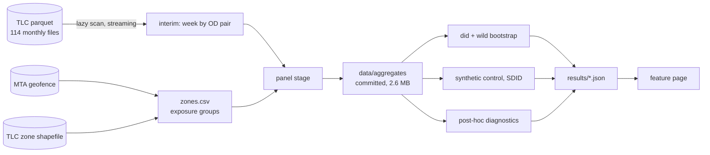

# cordon-effect

[](https://github.com/matejpopovski/cordon-effect/actions/workflows/ci.yml)

What did New York's congestion toll do to recorded taxi and Uber trips? This repo answers that from
1.3 billion TLC trip records, with the design committed before any estimate was run.
**[Read the feature page](https://matejpopovski.github.io/cordon-effect/).**

The obvious answer is -13.2%. It is wrong, or at least unsupported. The same regression returns
-9.6% with a fake start date a full year before the toll existed.


*Change in weekly trips, trailing 52-week average. Blue: trips touching the toll zone. Orange: trips
between zones 4 km or more away. The gap is real, but it was opening well before January 2025.*

## The result

The design fixed the wording of the verdict in advance. The primary estimate has a tight interval,
but it failed its fake-start placebo, so the verdict is **sensitive**.

| Estimate for trips touching the zone | Value | 95% interval | Status |
|---|---:|---:|---|
| Primary: core zones against zones 4 km or more away | -13.2% | -14.4% to -11.8% | Pre-specified, failed placebo |
| The same regression, fake start January 2024 | -9.6% | -10.5% to -8.7% | Pre-specified placebo |
| Synthetic control | -9.8% | -13.9% to -5.4% | Pre-specified, poor pre-period fit |
| Synthetic difference-in-differences | -7.1% | -11.2% to -2.9% | Pre-specified |
| Shift in growth at the toll, 26 weeks either side | -0.9% | -2.0% to +0.1% | Post-hoc |
| Same test at January 2024, no toll | +4.1% | +3.1% to +4.9% | Post-hoc |
| Same test at January 2026, no known event | -7.1% | -8.2% to -5.3% | Post-hoc |
| Departure from a pre-toll trend, through 2025 | -3.0% | -3.9% to -2.2% | Post-hoc |
| Zone against Upper East and West Side, pre-toll trend | -0.7% | -2.9% to +0.3% | Post-hoc |

Intervals are wild cluster restricted bootstrap (9,999 draws), except synthetic control and synthetic
DiD, which use placebo donors. `uv run cordon estimate` reproduces all of these from committed
aggregates, and they are written to [`results/`](results/).

Beyond what was pre-specified, the read is this: over the first year the toll moved these trips very
little, between about -3% and +1% across checks built to survive the trend. An effect of a few percent
either way cannot be excluded, because the same growth test moves by +4.1% and -7.1% in Januaries with
no toll. 2026 is unresolved. The event study shows a sharp step in January 2026 that this analysis
could not explain. Charge amounts did not change ([`results/fee_amounts.json`](results/fee_amounts.json))
and no rule change turned up.

Three findings carry the argument:

- **The gap does not follow the charge.** The Upper East and West Side pay no CRZ charge on most of
  these trips, yet they move almost as far against outer zones as the toll zone does.
- **The published design also fires without a toll.** An all-days approximation of
  [Pandey, Guler and Gayah (2026)](https://findingspress.org/article/155761) gets -6.1% against their -5.95%. The same comparison one year earlier gets -8.5%.
- **The centre-to-edge slope predates the toll.** The same gradient shows up at a fake 2024 start.

Nothing here measures total traffic, congestion or pollution. TLC records cover yellow taxis and
high-volume for-hire cars only.


## Why this is harder than it looks

**The treatment is not the toll.** For-hire vehicles do not pay $9. They pay $0.75 or $1.50 per trip,
day and night. The effect could go either way: a higher price pushes trips down, while faster streets
and former drivers might push them up. `cbd_congestion_fee` records this charge directly. It is
easy to confuse with `congestion_surcharge`, the separate $2.50 and $2.75 charge south of 96th Street
that has applied since 2019 and did not change.

**Taxi zones do not follow the boundary.** The toll line is 60th Street, but zones stop at 59th, and
the FDR and West Side Highway are excluded. Overlaying the MTA geofence on the zone shapefile gives 37
core zones and 7 mixed ones. The fee column then validates the map: charged share goes from 0.08% to
98.3% in one week, and it catches a zone geometry gets wrong, since Battery Park is 9% inside by area
but 96% charged on trips to outside zones.

**Comparison zones are contaminated.** Displaced drivers and riders change counts outside the zone,
which violates SUTVA. Rather than assume that away, exposed rings get their own coefficients, following
Butts (2023), and the analysis sizes displacement four ways. There is no gain just outside the line. A
uniform spread would be invisible to a gradient, so a bound covers it: even if every lost trip
reappeared in far zones, the estimate would still be -6.5%.

**There is one treated block.** Thirty-seven zones treated at once, in six spatial clusters, is not
thirty-seven experiments. MacKinnon and Webb (2017) show wild cluster bootstrap under-rejects with so
few treated clusters, so placebo tests carry the weight. That choice mattered. Randomisation over far
zones passes easily (p = 0.034), because no far block shares Manhattan's trend. Only the fake dates
could see it.

**Yellow records changed under the analysis.** See [DESIGN.md](DESIGN.md), deviation 1. Filtering
negative amounts, the usual cleaning step, would have deleted real Flex Fare trips, mostly after the
toll began, and faked a fall. Reversals are now matched pairs. Flex then grew into the outer
boroughs, which breaks far zones as a yellow comparison and makes the pre-specified -50.9% yellow
estimate an artifact.

## Decisions and what was rejected

**Commit the design first.** Commit `760da05` holds the design, pipeline and estimators, and contains
no estimates. Everything found later sits in the deviations log, and post-hoc work lives in its own
module, [`diagnostics.py`](src/cordon/diagnostics.py), and is labelled wherever it appears.

**Report the failed verdict.** The tempting move was to promote the post-hoc estimates to the
headline once the primary failed. The verdict stays as committed, and the post-hoc numbers are
presented as weaker evidence.

**Fit the trend on pre-toll weeks only.** The pre-specified linear trend check uses one slope across
all weeks, so post-toll movement leaks in. Its +0.9% looks like a clean null and is not. The post-hoc
version frees every post-toll week with its own term, so only pre-toll weeks can set the slope.

**A fast wild bootstrap instead of refitting.** Bootstrap scores are linear in the cluster weights, as
in Roodman et al. (2019), so 9,999 draws take a matrix product and test inversion needs no further
projection. All estimators run in about a minute.

**Concentrate out zones in PPML.** A dense statsmodels GLM peaked above 5 GB on this panel. Solving
for zone effects in closed form keeps the stage under 4 GB. A test holds the coefficient to
statsmodels' within 1e-7.

**Rejected:** PPML as the primary, since log-linear WLS makes the bootstrap cheap and the two agree
here (-13.2% both); zone-by-season effects, which spend too many parameters on two pre-years;
scanning remote parquet for the whole build, since a dropped connection mid-run costs more than the
disk; and a charting library, because hand-written SVG shares one drawing between the page and this
README and needs no JavaScript dependency.

## Running it

Python 3.12 with [uv](https://docs.astral.sh/uv/). These run from a clean clone with no network, using
the committed aggregates:

```sh
uv sync --locked --python 3.12
uv run pytest                 # synthetic-truth tests, plus claims pinned to results/
uv run cordon estimate        # every estimator, about a minute
uv run cordon report          # renders site/index.html and docs/figures/
```

To rebuild from raw records, which reads about 31 GB one month at a time and keeps almost none of it:

```sh
uv run cordon zones           # overlay the MTA geofence on TLC taxi zones
uv run cordon build           # download, aggregate and discard each month, resumable
uv run cordon panel           # collapse to data/aggregates/
uv run cordon feecheck        # charge amounts around January 2026
```

On an Apple M3 Max with 36 GB, shared with other jobs: `build` took 908 s at a peak of 3.65 GB, and
`estimate` about 65 s at a peak of 3.8 GB. See [`results/run_stats.json`](results/run_stats.json).



## Limitations

- Not a measure of traffic, congestion, emissions or air quality, and it does not contradict studies
  of those. Private cars, trucks and buses are not in these records.
- Green cabs and non-high-volume FHV bases are out of scope.
- A lost trip cannot be traced. The subway, a car, a bicycle and no trip at all look identical.
- Routes are unobserved, so a pass-through trip is visible only through the fee column.
- No driver identifier exists, so repositioning between trips cannot be seen. The displacement figure
  is a bound, not a measurement.
- The -3% to +1% range is post-hoc, selected after the primary failed. Formal intervals on those checks
  are too narrow: the same test varies by several points across Januaries.
- The pre-toll trend method is imperfect. At a fake start it returns -2.2%, so a couple of points of
  any figure may be drift.
- The January 2026 step, the rapid outer-borough growth, and the Flex Fare surge are all unexplained.
  A shock hitting the zone at the same moment as the toll cannot be ruled out, and a flat line could
  hide two offsetting effects.
- The published-design comparison is an approximation using all days, not the authors' weekday
  sample or code.
- Trip records are as filed. TLC states it makes no representation as to their accuracy, and vendor
  coding moved during the sample.

## Data

Trip records and zone files come from the
[NYC TLC](https://www.nyc.gov/site/tlc/about/tlc-trip-record-data.page), published through September
2026 at the time of this run. The TLC page states no licence, so raw parquet is never committed:
[`data/manifest.json`](data/manifest.json) records the URL, size, hash and row counts of each file,
and only aggregates are kept. The toll polygon is the MTA Central Business District Geofence from
[data.ny.gov](https://data.ny.gov/resource/srxy-5nxn.geojson), whose metadata lists no licence
either. Code is MIT.

Sources for each program fact are in [DESIGN.md](DESIGN.md).
